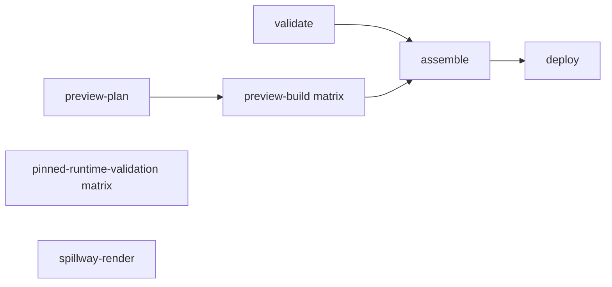
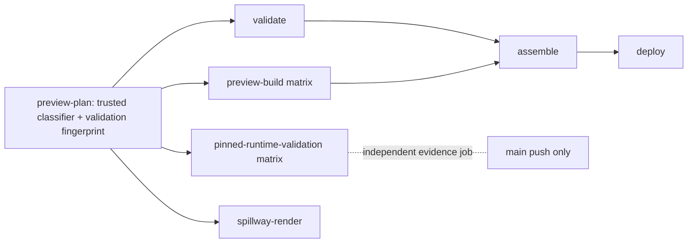

# CI Validation Optimization: Evidence Report

**Date:** 2026-10-14 
**Branch:** `engineering/ci-validation-optimization-001` 
**Starting `main`:** `e5a49a7f94387b26c1ae91221bdf2217df273448` 
**Pushed implementation checkpoint:** `8e29aaaf63184332e9f6624b18f9bf3505c9ee2c` 
**Scope:** CI-1 implementation only; CI-2 deployment design/evidence only. No merge or production deployment is authorized.

## Status

**Local implementation: PASS. Hosted acceptance: BLOCKED.** The isolated candidate passes Node 22 local validation and was pushed to the authorized branch. No CI-1 PR or GitHub Actions run has been created or observed from this environment because `gh` has no authenticated account, the configured `GH_TOKEN` is rejected, and the environment proxy denies `api.github.com`. Therefore the documentation fast path, trusted artifact reuse, required-check behavior, hosted Node 22 validation, and the under-five-minute target have not been demonstrated in hosted CI. Do not treat this report as approval to merge.

The original `/workspace/manacondas-minigame-mayhem` worktree remains on `design/neon-grid-circuit-02` at `6919729ba5e12f48305f543dca153f4ba9c5ae19`; implementation took place in a separate worktree based on the exact `main` checkpoint above.

## Observed baseline

| Run                                                                                               | PR / purpose | Total workflow duration | Evidence                   |
| ------------------------------------------------------------------------------------------------- | ------------ | ----------------------: | -------------------------- |
| [38445529495](https://github.com/Manaconda33/manacondas-minigame-mayhem/actions/runs/38445529495) | PR #298      |                  19m 1s | Public run page            |
| [38454352580](https://github.com/Manaconda33/manacondas-minigame-mayhem/actions/runs/38454352580) | PR #299      |                 17m 21s | Public run page            |
| [38485133171](https://github.com/Manaconda33/manacondas-minigame-mayhem/actions/runs/38485133171) | PR #300      |                 18m 31s | Public run and step timing |

For run `38485133171`, the V3.2 exact pinned-runtime validation step ran **17m 42s** (23:35:48–23:53:30 UTC). It performed strict typecheck, zero-warning lint, the full coverage suite with `--maxWorkers=1 --testTimeout=15000`, production build, and preview-relative build. npm dependencies restored from cache; the separate validation `node_modules` cache missed, and all validation phases ran. The pinned preview build itself restored from its existing build cache in about two seconds. That cache is build acceleration and was never treated as test evidence.

Across these runs, `validate` took about 1m18s–2m16s, `preview-plan` 7–12s, and spillway rendering 30–48s. `preview-build` contained 22 pinned preview variants with `max-parallel: 8`; four historical immutable runtimes were validated as a separate matrix. These are observed timings, not a newly measured critical-path profile for every job. Public job pages did not provide authenticated detailed cache-retention or all step data in this environment.

Observed cache behavior: the #300 V3.2 run restored npm dependencies but missed the application `node_modules` cache; its immutable preview output cache hit and took about two seconds. Repository cache usage/eviction, artifact-policy maximum retention and organization storage quota are not accessible without authenticated settings. CI-1 treats caches only as dependency/build acceleration. Evidence artifacts are requested for 30 days; an expired artifact is an explicit full-validation miss.

Workflow links for the two reported production failures:

- [38452972000](https://github.com/Manaconda33/manacondas-minigame-mayhem/actions/runs/38452972000) failed pre-deployment production-preservation verification.
- [38456834757](https://github.com/Manaconda33/manacondas-minigame-mayhem/actions/runs/38456834757) failed post-deployment live-byte verification.

The exact mismatching paths, response status, or bytes from those jobs are **unknown** here: detailed step logs require authenticated Actions access. This change does not alter deployment retries, preservation checks, or byte-integrity policy.

## Workflow graphs

Observed main deployment dependency path before CI-1:

CI-1 adds `preview-plan` as a conservative gate for the existing PR checks. It leaves the Pages assembly/deploy dependency path and scripts unchanged:

For documentation-only pull requests, all pre-existing job and matrix identities remain instantiated and finish with explicit no-op summaries. This preserves matrix child check runs even though their expensive steps are intentionally skipped. If the classifier, trusted helpers, fetch, diff parse, or plan job cannot establish a complete allowlisted diff, the `always()` fallback selects full validation.

## CI-1 implementation

- A raw Git diff classifier permits only root `README.md` and ordinary Markdown under `docs/design/**` or `docs/superpowers/plans/**`. Renames inspect both paths. Adds, edits, and deletions require regular-file modes. Generated/evidence paths, governance docs, runtime/build/config/workflow/test/dependency/assets and all uncertain records select full validation.
- PR classification and fingerprint code are checked out from the target branch and run against the PR checkout. If the target branch does not yet contain trusted helpers (the expected state for the first CI-1 PR run), classification is false and full validation runs. The PR cannot supply the code that decides its own docs-only status.
- `git diff --check` runs in `preview-plan` for allowlisted docs. The existing `validate` check reports the tests it intentionally did not run; the summary explicitly does not claim the runtime suite passed.
- Documentation-only runs skip expensive steps inside the existing `preview-build`, `pinned-runtime-validation`, and `spillway-render` jobs; matrix entries still report success. A failed/missing plan falls through to full work.
- Reusable evidence covers all four existing historical pinned-runtime entries (Billboard, Waterfall Dive, 300 m visibility, and Abyss Fog V3.2). A GitHub Actions artifact manifest is eligible only if it was uploaded after successful exact validation in a `push` run on `main`, and its run/event/ref/path/commit/attempt, pinned source SHA/tree, package lock, normalized LFS inventory digest (`6e084bd177f53ac87a15642acf0054e7fe398a22387274e80fb0565f1e1a293c` for these four source pins), validation/workflow fingerprint, Node/npm/runner image, and full command list match. The downloaded artifact archive digest and its single-file manifest layout are checked before evidence is accepted.
- The evidence lookup uses a job-scoped `actions:read` and `contents:read` token, and reads only artifacts associated with successful main push runs. PR jobs never upload reusable PASS artifacts; `pull_request_target` and cache-as-proof are not used. Missing, expired, invalid, unavailable, or mismatched evidence takes the exact full-validation branch. Retention is 30 days; expiry costs time, not coverage.
- The old pinned validation cache marker is removed. Dependency caches and immutable preview-build caches remain acceleration only.
- `assemble`, `deploy`, production preservation, deployment retries, Pages configuration, and live-byte verification are unchanged. No top-level permission or branch rule is changed.

Changed-file inventory:

- `.github/workflows/ci.yml`
- `tools/ci/pr-change-classifier.mjs`
- `tools/ci/validation-input-fingerprint.mjs`
- `tools/ci/pinned-validation-evidence.mjs`
- `tools/ci/restore-pinned-validation-evidence.mjs`
- `tools/ci/write-pinned-validation-evidence.mjs`
- `tools/ci/pr-change-classifier.d.mts`
- `tools/ci/pinned-validation-evidence.d.mts`
- `tests/ci-validation-optimization.test.ts`
- `eslint.config.js`, `tsconfig.app.json`
- `docs/superpowers/plans/2026-10-14-ci-validation-optimization.md`
- `docs/evidence/2026-10-14-ci-validation-optimization/report.md`
- `docs/IMPLEMENTATION-STATUS.md`, `docs/DECISIONS.md`, `docs/TESTING.md`

No files were removed. No runtime source, artwork, LFS pointer, gameplay/build output, Pages root artifact, or production deployment code was intentionally modified.

## Tests and local validation

Clean dependency installation and full validation were run under Node `22.23.3` and npm `10.9.9`, using a temporary Node/npm package installation and a clean task-worktree `npm ci`:

| Command / check                          | Result                                                                                                                                                                                                      |
| ---------------------------------------- | ----------------------------------------------------------------------------------------------------------------------------------------------------------------------------------------------------------- |
| Focused CI optimization tests            | PASS, 23 tests                                                                                                                                                                                              |
| `npm run typecheck`                      | PASS                                                                                                                                                                                                        |
| `npm run lint`                           | PASS, zero warnings                                                                                                                                                                                         |
| `npm run test:ci` via `npm run validate` | PASS, 104 files / 822 tests                                                                                                                                                                                 |
| `npm run build` via `npm run validate`   | PASS; existing >500 kB chunk warning remains                                                                                                                                                                |
| Asset gates during build                 | PASS for approved SFX, music, branding, terrain, archived/Results assets, track textures, GLBs, PNGs, and Route Night backdrop                                                                              |
| `git lfs fsck`                           | PASS                                                                                                                                                                                                        |
| `git diff --check`                       | PASS                                                                                                                                                                                                        |
| GitHub Actions YAML parse                | PASS (PyYAML syntax parse; not a GitHub-hosted workflow execution)                                                                                                                                          |
| Prettier check                           | PASS for the authored config, CI tools/tests, plan and evidence report; the full workflow/governance files already fail Prettier on baseline `main`, so those historical files were not broadly reformatted |

The automated tests cover README/planning-Markdown fast paths; runtime, tests, CI helper, workflow, dependency, asset and governance changes; rename/delete/mode/malformed/incomplete cases; exact successful trusted evidence; missing, mismatched, expired, PR-origin, failed, cancelled and incomplete evidence; artifact digest rejection; full-validation fallback; and preservation of named jobs/no workflow path filters/no privileged PR trigger. These fixtures prove helper behavior only. They do not prove GitHub required-check settings or actual hosted runs.

Prettier caveat: a full-file check of the modified workflow and governance Markdown reports formatting drift, and the same check also fails against those files from the unmodified starting `main` commit. The candidate retains the deployment assembly/deploy job bytes exactly rather than reformatting historical workflow content. The changed configuration, CI tools/tests, plan and new evidence report pass targeted Prettier; workflow YAML syntax is independently parsed successfully.

## GitHub, permissions, and required-check limitations

- GitHub write ability is not available: `gh auth status` reports no authenticated host and the configured `GH_TOKEN` is invalid. The GitHub API tunnel is denied by the environment proxy. Branch rulesets and required-check settings also return unavailable/404 to this identity.
- The isolated branch push succeeded and remote `main` still points to the verified base SHA. No PR, Actions run, branch-protection mutation, or hosted docs-only fixture is claimed. Hosted cross-run artifact API access, artifact digest format, status-check identities, Node 22 Actions behavior and wall-clock improvement remain unverified.
- The CI-1 implementation PR's first run should run full validation because target `main` lacks the trusted helpers. It cannot be called the warmed documentation-only measurement. To establish the target, merge approval would be needed after review, then a separate docs-only test PR and hosted evidence-hit test; merge is outside this authorization.
- Keep this item **BLOCKED** until a hosted PR confirms all original required status checks finish and the warmed docs-only path is below five minutes (target 2–3 minutes). Do not infer protection behavior from workflow YAML alone.

## CI-2 design only

Do not implement in CI-1. Recommended next design:

1. Produce a deploy manifest of path, byte count, and SHA-256 for production-root files and every immutable preview. Compare the assembled manifest with the current deployed manifest; skip Pages redeployment when deployable bytes are identical, while still running required validation.
2. Reuse accepted preview output only from retained GitHub artifacts with exact source commit/tree, workflow/toolchain/dependency identity, artifact digest, and manifest provenance. Rebuild on missing/expired/mismatched evidence. Never use mutable cache contents as authoritative production bytes.
3. Assemble from source-pinned production and preview artifacts; assert production-root bytes are unchanged when the current change is not an authorized gameplay/runtime release. Preserve every already accepted preview path and source SHA.
4. In delivery verification, retry only bounded transient transport conditions and any explicitly justified propagation response; compare hashes after each successful fetch. A byte/hash mismatch is a hard integrity failure with path/hash evidence, never a retryable network error.
5. Preserve Pages environment protection, LFS fsck, deployment artifact provenance, rollback inputs, and full audit manifests.

Before setting retry behavior, obtain authenticated logs for runs `38452972000` and `38456834757` and identify the exact failing path and failure class. Current evidence establishes only the failing stages, not their root causes. No retry or integrity-check change is recommended until those causes are known.

## Release / approval state

CI-1 is **not hosted-validated or merged**. CI-2 is **design only**. Production deployment, PR #242, Neon Grid runtime, G-05, and gameplay acceptance are unaffected. Owner action needed to unlock the remaining gate: provide an authenticated GitHub session/API route for this environment or create the requested PR from the pushed isolated branch, then review actual hosted results. Do not merge until hosted requirements and existing required checks are demonstrated.
