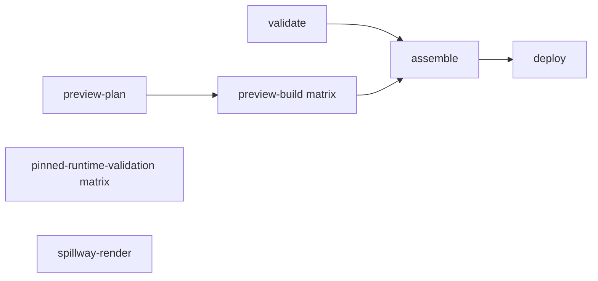
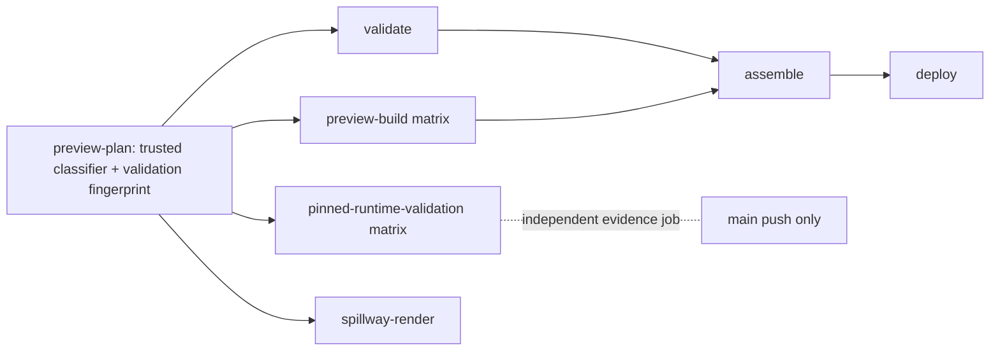

# CI Validation Optimization: Evidence Report

**Date:** 2026-10-14 
**Branch:** `engineering/ci-validation-optimization-001` 
**Starting `main`:** `e5a49a7f94387b26c1ae91221bdf2217df273448` 
**Initial implementation checkpoint:** `8e29aaaf63184332e9f6624b18f9bf3505c9ee2c` 
**Scope:** CI-1 implementation only; CI-2 deployment design/evidence only. No merge or production deployment is authorized.

## Status

**Local validation: PASS. Earlier candidate hosted validation: PASS; current correction hosted validation: verify on the final PR head.** PR [#301](https://github.com/Manaconda33/manacondas-minigame-mayhem/pull/301) remains open and unmerged. The first hosted run, [38496195901](https://github.com/Manaconda33/manacondas-minigame-mayhem/actions/runs/38496195901), passed the main `validate` job in 1m23s but failed all four pinned-runtime validation children at the same preflight step. Investigation found the expected normalized LFS inventory digest was wrong: the four exact pinned source trees compute `234d0e7336e2d824e9af54f107a2628ce544b42a2260bafb2d32d8e807c765bc`, while the matrix expected `6e084bd177f53ac87a15642acf0054e7fe398a22387274e80fb0565f1e1a293c`. A regression test reproduced the mismatch before the matrix was corrected. The correction was pushed in commit `478927e007a37034625903d0d49bfedb2dcde798`; hosted rerun [38497241491](https://github.com/Manaconda33/manacondas-minigame-mayhem/actions/runs/38497241491) passed in **19m13s**. Its `validate`, preview-plan/build, spillway-render, and all four pinned-runtime jobs succeeded; `assemble` and `deploy` were skipped as expected for a pull request. The pinned full-validation steps took Billboard 3m36s, Dive 3m24s, Far300 4m32s, and Abyss Fog 18m29s. This run validates the full path, not the documentation-only fast path or a trusted-evidence hit. Do not treat it as merge approval.

**Review correction superseding the earlier artifact design:** the current branch moves evidence generation into a new main-push-only workflow. The previous hosted passes `38497241491` and `38499198903` predate this correction and are not validation evidence for it. The PR Checks tab links the current exact-head run. The main-only producer, its real artifact upload, and a real consumer hit remain an explicit post-merge bootstrap gate; no docs-only timing result or trusted artifact hit is claimed here.

The original `/workspace/manacondas-minigame-mayhem` worktree remains on `design/neon-grid-circuit-02` at `6919729ba5e12f48305f543dca153f4ba9c5ae19`; implementation took place in a separate worktree based on the exact `main` checkpoint above.

## Observed baseline

| Run                                                                                               | PR / purpose | Total workflow duration | Evidence                   |
| ------------------------------------------------------------------------------------------------- | ------------ | ----------------------: | -------------------------- |
| [38445529495](https://github.com/Manaconda33/manacondas-minigame-mayhem/actions/runs/38445529495) | PR #298      |                  19m 1s | Public run page            |
| [38454352580](https://github.com/Manaconda33/manacondas-minigame-mayhem/actions/runs/38454352580) | PR #299      |                 17m 21s | Public run page            |
| [38485133171](https://github.com/Manaconda33/manacondas-minigame-mayhem/actions/runs/38485133171) | PR #300      |                 18m 31s | Public run and step timing |

For run `38485133171`, the V3.2 exact pinned-runtime validation step ran **17m 42s** (23:35:48–23:53:30 UTC). It performed strict typecheck, zero-warning lint, the full coverage suite with `--maxWorkers=1 --testTimeout=15000`, production build, and preview-relative build. npm dependencies restored from cache; the separate validation `node_modules` cache missed, and all validation phases ran. The pinned preview build itself restored from its existing build cache in about two seconds. That cache is build acceleration and was never treated as test evidence.

Across these runs, `validate` took about 1m18s–2m16s, `preview-plan` 7–12s, and spillway rendering 30–48s. `preview-build` contained 22 pinned preview variants with `max-parallel: 8`; four historical immutable runtimes were validated as a separate matrix. These are observed timings, not a newly measured critical-path profile for every job. Public job pages did not provide authenticated detailed cache-retention or all step data in this environment.

Observed cache behavior: the #300 V3.2 run restored npm dependencies but missed the application `node_modules` cache; its immutable preview output cache hit and took about two seconds. Repository cache usage/eviction, artifact-policy maximum retention and organization storage quota are not accessible without authenticated settings. CI-1 treats caches only as dependency/build acceleration. Evidence artifacts are requested for 30 days; an expired artifact is an explicit full-validation miss.

Workflow links for the two reported production failures:

- [38452972000](https://github.com/Manaconda33/manacondas-minigame-mayhem/actions/runs/38452972000) failed pre-deployment production-preservation verification.
- [38456834757](https://github.com/Manaconda33/manacondas-minigame-mayhem/actions/runs/38456834757) failed post-deployment live-byte verification.

The exact mismatching paths, response status, or bytes from those jobs are **unknown** here: detailed step logs require authenticated Actions access. This change does not alter deployment retries, preservation checks, or byte-integrity policy.

## Workflow graphs

Observed main deployment dependency path before CI-1:

CI-1 adds `preview-plan` as a conservative gate for the existing PR checks. It leaves the Pages assembly/deploy dependency path and scripts unchanged:

For documentation-only pull requests, all pre-existing job and matrix identities remain instantiated and finish with explicit no-op summaries. This preserves matrix child check runs even though their expensive steps are intentionally skipped. If the classifier, trusted helpers, fetch, diff parse, or plan job cannot establish a complete allowlisted diff, the `always()` fallback selects full validation.

## CI-1 implementation

- A raw Git diff classifier permits only root `README.md` and ordinary Markdown under `docs/design/**` or `docs/superpowers/plans/**`. Renames inspect both paths. Adds, edits, and deletions require regular-file modes. Generated/evidence paths, governance docs, runtime/build/config/workflow/test/dependency/assets and all uncertain records select full validation.
- PR classification and fingerprint code are checked out from the target branch and run against the PR checkout. If the target branch does not yet contain trusted helpers (the expected state for the first CI-1 PR run), classification is false and full validation runs. The PR cannot supply the code that decides its own docs-only status.
- `git diff --check` runs in `preview-plan` for allowlisted docs. The existing `validate` check reports the tests it intentionally did not run; the summary explicitly does not claim the runtime suite passed.
- Documentation-only runs skip expensive steps inside the existing `preview-build`, `pinned-runtime-validation`, and `spillway-render` jobs; matrix entries still report success. A failed/missing plan falls through to full work.
- Reusable evidence covers all four existing historical pinned-runtime entries (Billboard, Waterfall Dive, 300 m visibility, and Abyss Fog V3.2). A GitHub Actions artifact manifest is eligible only if it was uploaded after successful exact validation in a `push` run on `main`, and its run/event/ref/path/commit/attempt, pinned source SHA/tree, package lock, normalized LFS inventory digest (`234d0e7336e2d824e9af54f107a2628ce544b42a2260bafb2d32d8e807c765bc` for these four source pins), validation/workflow fingerprint, Node/npm/runner image, and full command list match. The downloaded artifact archive digest and its single-file manifest layout are checked before evidence is accepted.
- The evidence lookup uses a job-scoped `actions:read` and `contents:read` token, and reads only artifacts associated with successful main push runs. PR jobs never upload reusable PASS artifacts; `pull_request_target` and cache-as-proof are not used. Missing, expired, invalid, unavailable, or mismatched evidence takes the exact full-validation branch. Retention is 30 days; expiry costs time, not coverage.
- The old pinned validation cache marker is removed. Dependency caches and immutable preview-build caches remain acceleration only.
- PR #301's first hosted run exposed a bad LFS inventory checksum in the new exact-source preflight. `git lfs ls-files -l <pin>` plus the workflow's normalization pipeline yields `234d0e7336e2d824e9af54f107a2628ce544b42a2260bafb2d32d8e807c765bc` for each of the four historical source pins; the workflow had `6e084bd177f53ac87a15642acf0054e7fe398a22387274e80fb0565f1e1a293c`. The matrix and regression-test fixture now use the measured digest. Run `38496195901` is a failed first attempt; corrected run `38497241491` passed the full hosted validation in 19m13s.
- `assemble`, `deploy`, production preservation, deployment retries, Pages configuration, and live-byte verification are unchanged. No top-level permission or branch rule is changed.

Changed-file inventory:

- `.github/workflows/ci.yml`
- `tools/ci/pr-change-classifier.mjs`
- `tools/ci/validation-input-fingerprint.mjs`
- `tools/ci/pinned-validation-evidence.mjs`
- `tools/ci/restore-pinned-validation-evidence.mjs`
- `tools/ci/write-pinned-validation-evidence.mjs`
- `tools/ci/pr-change-classifier.d.mts`
- `tools/ci/pinned-validation-evidence.d.mts`
- `tests/ci-validation-optimization.test.ts`
- `eslint.config.js`, `tsconfig.app.json`
- `docs/superpowers/plans/2026-10-14-ci-validation-optimization.md`
- `docs/evidence/2026-10-14-ci-validation-optimization/report.md`
- `docs/IMPLEMENTATION-STATUS.md`, `docs/DECISIONS.md`, `docs/TESTING.md`

No files were removed. No runtime source, artwork, LFS pointer, gameplay/build output, Pages root artifact, or production deployment code was intentionally modified.

## Tests and local validation

Clean dependency installation and full validation were run under Node `22.23.3` and npm `10.9.9`, using a temporary Node/npm package installation and a clean task-worktree `npm ci`:

| Command / check                          | Result                                                                                                                                                                                                      |
| ---------------------------------------- | ----------------------------------------------------------------------------------------------------------------------------------------------------------------------------------------------------------- |
| Focused CI optimization tests            | PASS, 24 tests                                                                                                                                                                                              |
| `npm run typecheck`                      | PASS                                                                                                                                                                                                        |
| `npm run lint`                           | PASS, zero warnings                                                                                                                                                                                         |
| `npm run test:ci` via `npm run validate` | PASS, 104 files / 823 tests                                                                                                                                                                                 |
| `npm run build` via `npm run validate`   | PASS; existing >500 kB chunk warning remains                                                                                                                                                                |
| Asset gates during build                 | PASS for approved SFX, music, branding, terrain, archived/Results assets, track textures, GLBs, PNGs, and Route Night backdrop                                                                              |
| `git lfs fsck`                           | PASS                                                                                                                                                                                                        |
| `git diff --check`                       | PASS                                                                                                                                                                                                        |
| GitHub Actions YAML parse                | PASS (PyYAML syntax parse; not a GitHub-hosted workflow execution)                                                                                                                                          |
| Prettier check                           | PASS for the authored config, CI tools/tests, plan and evidence report; the full workflow/governance files already fail Prettier on baseline `main`, so those historical files were not broadly reformatted |

The automated tests cover README/planning-Markdown fast paths; runtime, tests, CI helper, workflow, dependency, asset and governance changes; rename/delete/mode/malformed/incomplete cases; exact successful trusted evidence; missing, mismatched, expired, PR-origin, failed, cancelled and incomplete evidence; artifact digest rejection; full-validation fallback; and preservation of named jobs/no workflow path filters/no privileged PR trigger. These fixtures prove helper behavior only. They do not prove GitHub required-check settings or actual hosted runs.

Prettier caveat: a full-file check of the modified workflow and governance Markdown reports formatting drift, and the same check also fails against those files from the unmodified starting `main` commit. The candidate retains the deployment assembly/deploy job bytes exactly rather than reformatting historical workflow content. The changed configuration, CI tools/tests, plan and new evidence report pass targeted Prettier; workflow YAML syntax is independently parsed successfully.

## GitHub, permissions, and required-check limitations

- Git branch write succeeded and PR #301 is open. `gh auth status` reports no authenticated account and the configured `GH_TOKEN` is invalid; the API hostname is outside the current executor egress policy. Public GitHub run pages expose check status, but detailed step logs require sign-in. Branch rulesets and required-check settings remain unavailable to this identity.
- Hosted run `38497241491` is a successful full-path PR validation, total 19m13s. The four pinned-runtime full-validation steps all succeeded; the Abyss Fog step took 18m29s and determined the critical path. This confirms runtime-change/full-validation behavior and that the bad digest is corrected.
- The documentation-only path and trusted-evidence hit cannot be hosted-tested before merge: the workflow only triggers PRs targeting `main`, while `main` does not yet contain the trusted classifier/verifier. A PR against the candidate branch would not trigger this workflow; a docs-only PR to `main` cannot inherit the candidate workflow without also changing the workflow file, which correctly forces full validation. Post-merge fixture validation requires separate merge approval. Cross-run artifact access/hit, artifact digest behavior against GitHub, required-check/ruleset identities and the <5-minute timing goal therefore remain unverified. Public run pages confirm the job outcomes but not branch-protection configuration; authenticated GitHub API access is unavailable.
- Keep this item **BLOCKED for merge recommendation** until the owner has the post-merge evidence needed to verify the warmed docs-only path and trusted artifact reuse. The current candidate's full hosted checks pass, but CI-1 is unmerged and this report does not claim the under-five-minute target or required-check protection behavior.

## CI-2 design only

Do not implement in CI-1. Recommended next design:

1. Produce a deploy manifest of path, byte count, and SHA-256 for production-root files and every immutable preview. Compare the assembled manifest with the current deployed manifest; skip Pages redeployment when deployable bytes are identical, while still running required validation.
2. Reuse accepted preview output only from retained GitHub artifacts with exact source commit/tree, workflow/toolchain/dependency identity, artifact digest, and manifest provenance. Rebuild on missing/expired/mismatched evidence. Never use mutable cache contents as authoritative production bytes.
3. Assemble from source-pinned production and preview artifacts; assert production-root bytes are unchanged when the current change is not an authorized gameplay/runtime release. Preserve every already accepted preview path and source SHA.
4. In delivery verification, retry only bounded transient transport conditions and any explicitly justified propagation response; compare hashes after each successful fetch. A byte/hash mismatch is a hard integrity failure with path/hash evidence, never a retryable network error.
5. Preserve Pages environment protection, LFS fsck, deployment artifact provenance, rollback inputs, and full audit manifests.

Before setting retry behavior, obtain authenticated logs for runs `38452972000` and `38456834757` and identify the exact failing path and failure class. Current evidence establishes only the failing stages, not their root causes. No retry or integrity-check change is recommended until those causes are known.

## Final architecture review correction

### Independent evidence producer

`.github/workflows/trusted-pinned-runtime-validation.yml` now runs only on pushes to `main`. It has `contents: read` only, no Pages/deploy permissions, and no PR or `workflow_run` trigger. The Pages `CI` workflow continues to own application validation and deployment but no longer writes trusted evidence. The producer checks out the exact main commit and each pinned SHA/tree; verifies the lockfile and normalized LFS inventory; sets up Node 22; runs `npm ci`; executes the complete pin-specific validation and preview build; then writes and uploads the one-file manifest. Its external actions are pinned to full commit SHAs: checkout `08c6903cd8c0fde910a37f88322edcfb5dd907a8` (v5.0.0), setup-node `a0853c24544627f65ddf259abe73b1d18a591444` (v5.0.0), and upload-artifact `ea165f8d65b6e75b540449e92b4886f43607fa02` (v4.6.2). Those immutable references are part of the workflow fingerprint. It does not restore a `node_modules` cache, so a mutable installed-tree cache cannot stand in for dependency installation or tests. A package-download cache remains only an acceleration.

The consumer accepts only a completed successful run from that exact workflow on `push` to `main`, with one successful matrix job matching the stable runtime ID and same run attempt. The API result must show success for the source checkout, fingerprint, exact asset verification, Node setup, `npm ci`, full validation, evidence write, and artifact upload steps. The manifest and artifact archive digest must then match the exact source/tree, test contract, both workflow inputs, dependency lockfiles, LFS inventory, Node/npm/runner identity and commands. Artifacts from `ci.yml` are rejected even if its app checks passed before Pages failed. Failed/cancelled/incomplete runs, producer jobs or required steps are rejected. Any missing/expired/malformed/API/integrity mismatch remains a full-validation fallback.

The successful unit fixture is not a real hosted artifact hit. The dedicated producer cannot run on this unmerged PR by design. If upload permission or artifact API behavior fails after merge, no evidence is reused and PR validation falls back to full tests. Do not grant broader permissions to make reuse work.

### Status-check contract

The existing `validate` job ID remains unchanged and now has explicit name `validate`. It still means full application typecheck/lint/tests/build for non-doc changes and an honest allowlisted-docs pass with explicit skipped checks. Matrix display names are now explicit: `preview-build (<matrix.id>)` and `pinned-runtime-validation (<matrix.id>)`; expanded SHA/tree/lock metadata no longer alters their labels. This is a display-name stabilization only and does not change branch rules.

Manny reports the active main ruleset requires only `validate`; authenticated settings could not be independently queried from this cloud environment. The separate `preview-plan`, preview-build children, pinned-runtime PR children, and `spillway-render` checks are not individually enforced merge blockers under that rule, and `validate` does not aggregate them. The main-push trusted evidence workflow is not a PR check. No branch protection, required context or repository permission was changed. If separate preview/render checks must block merges, that requires a later explicit ruleset decision.

### Bootstrap, hosted proof and rollback

The post-merge sequence, requiring Manny's separate approval to merge PR #301, is:

1. Verify the independent workflow ran on the merged `main` SHA and completed successfully. Confirm all four stable matrix jobs and nine required producer steps per job succeeded; verify all four retained artifact names/digests and their exact pin, tree, contract, lock and LFS identities.
2. Open a temporary, unmerged PR changing only a non-allowlisted governance document such as `docs/TESTING.md`. Confirm full app validation runs and all four pinned jobs report a trusted artifact hit from that workflow/run. Close the fixture without merging.
3. Open a separate temporary README-only PR. Confirm the trusted base classifier reports docs-only, `git diff --check` passes, every existing matrix check reports its skip accurately, and measure actual PR completion. Claim the under-five-minute target only if the hosted result meets it. Close without merging.
4. Recheck that `validate` is still the required ruleset context. Do not change protection or permissions as part of this verification.

If the producer or artifact lookup fails, full validation is the safe fallback; treat performance reuse as blocked and investigate without broadening permissions. If any foreign/failed evidence or unsafe docs diff is ever accepted, stop reuse and revert CI-1 through a standard protected revert PR. Do not force-push, disable checks, or change the thresholds.

The current active-ruleset fact is owner-reported, because `gh auth status` showed an invalid local CLI token and `api.github.com` is outside this environment's allowed egress destinations. Public Git fetch is available; this does not establish Actions API or ruleset read access. The direct Pages workflow run pages for `38452972000` and `38456834757` load publicly, but their authenticated step logs are not accessible here, so the exact failing paths/statuses/bytes remain unknown. CI-2 is unchanged and unimplemented.

### Local validation for this architecture correction

Under Node `22.23.3` / npm `10.9.9`, a clean `npm ci` and `npm run validate` passed: strict typecheck, zero-warning lint, **104 test files / 828 tests**, repository asset integrity gates, and production build. The focused CI optimization suite passed **29/29**. The new fingerprint regression was observed RED when only `ci.yml` was identified as the workflow blob, then GREEN after binding it to the new trusted producer workflow. `git lfs fsck`, `git diff --check`, and PyYAML parsing of both workflow files passed. Targeted Prettier passed authored CI helper/test/new-workflow files; `.github/workflows/ci.yml` still reports the existing full-file formatting drift and was not reformatted wholesale. The existing Vite large-chunk warning remains. The live PR Checks tab is the hosted status source for the final pushed correction; earlier passes apply to earlier commits only.

## Release / approval state

CI-1 full validation is **PASS; merge remains unapproved and the PR is open**. CI-2 is **design only**. Production deployment, PR #242, Neon Grid runtime, G-05, and gameplay acceptance are unaffected. The docs-only hosted fast path, trusted artifact hit, GitHub-required-check configuration, and <5-minute target remain unverified pending a separately approved merge and post-merge fixture. Do not merge without Manny's separate approval.

### Exact-head hosted correction run

Hosted correction run [38506526760](https://github.com/Manaconda33/manacondas-minigame-mayhem/actions/runs/38506526760) on `9bbc8e4e2ceff0dbe453830a18e9253f5da1f1c1` completed with `validate`, `preview-plan`, all preview-build children, `spillway-render`, and pinned Billboard, Far300, and Abyss Fog validation successful; assemble/deploy were skipped as expected on a PR. The pinned Dive child failed in `run full validation on miss (exact pinned runtime)` with exit code 1. That step combines source/LFS preflight and `npm run validate`, and the accessible public check page does not expose its detailed log, so the failing subcommand is unknown. A separate local checkout of the exact Dive source `b49d9876f8c6ce87956f8b91675c3c8180e56b55` passed `git lfs pull && git lfs fsck`, `npm ci`, and `npm run validate` under Node `22.23.3` / npm `10.9.9` (125 files / 995 tests, typecheck, lint, assets, build). This local pass does not clear the hosted failure. Keep hosted validation marked BLOCKED until the failed job is rerun or its logs identify and resolve the cause.

### Required-check failure propagation correction — 2026-10-14

This correction starts from verified candidate `3528f90390c41f4408d16a331e84564a91ffaa0b`. Root cause: job `validate` kept the stable required check identity via `needs: preview-plan` and `if: always()`, while its validation steps treated an unsuccessful plan result as a request to run the full suite. Therefore a passing suite could let required `validate` succeed even though `preview-plan` or its documentation diff check had failed.

The bounded fix retains `validate`, keeps the job runnable after dependency failure, and adds an `always()` gate after checkout. The gate succeeds only when `needs.preview-plan.result` is exactly `success`; otherwise it exits nonzero before any application-validation step. All full-validation steps now require a successful plan and either a non-PR event or `docs_only != true`. Thus a successful uncertain/non-allowlisted classification still receives the full suite, while an actual failed/cancelled/skipped plan cannot pass the required check. Successful allowlisted docs-only planning still reports its existing fast path. Preview matrices, pinned-runtime tests/evidence, spillway, production assembly/deployment, permissions, branch protections, and CI-2 were not modified.

Regression tests cover the gate's success/failure/cancelled/skipped/unknown outcomes; a temporary repository with trailing whitespace produces a real failing `git diff --check`, and the required-check gate rejects its resulting failed plan. Workflow contract checks bind the docs diff step to `preview-plan`, ensure it is not masked, verify the stable `validate` gate and each full-validation condition, and preserve the docs-only conditions. A successful `docs_only=false` plan remains on the full-validation path, distinct from unsuccessful planning, which fails the gate.

Final local validation under Node `22.23.3` / npm `11.9.0`: `npm run validate` passed strict typecheck, zero-warning lint, **104 files / 830 tests**, asset gates and production build; focused CI optimization tests **31/31 passed**; LFS fsck, whitespace check, Node syntax check, workflow YAML parse, and targeted Prettier checks passed. The build emits the repository's existing >500 kB chunk warning. The default Node 24 environment initially exposed two native-test expectations tied to the older `node --test` TAP output; all tests pass under CI's supported Node 22.

Manny reports the active main ruleset requires only `validate`. This could not be independently queried because the current environment's GitHub API request is forbidden; the prior ruleset observation remains owner-reported. Preview-plan, preview-build children, pinned-runtime PR jobs, and spillway are not individually required. No branch protection was changed. The previously successful exact-head run `38508322327` belongs to SHA `3528f90390c41f4408d16a331e84564a91ffaa0b` and does not validate this correction. Use the current [PR #301 Checks](https://github.com/Manaconda33/manacondas-minigame-mayhem/pull/301/checks) for the final source result; do not merge until that exact-head hosted run is successful. The docs-only fast-path timing, trusted artifact hit, and <5-minute target remain post-merge bootstrap gates and are not claimed.

### PR #303 trusted evidence writer repair — exact-head verification

The correction commit `764a510e14f81021771023bdc46feb36af09e8d5` is on the existing draft PR #303 branch, based on verified `main` `178750c4a6b078398d8c20a6d33e684531c2e025`. The writer imports `fingerprintValidationInputs` from its actual exporting module, `tools/ci/validation-input-fingerprint.mjs`. Its regression test still asks Node's native ESM loader to resolve the named imports from the source writer; it guards absent regex captures and invokes `execFileSync` using the repository's supported two-argument declaration. A negative control with the old incorrect import failed with Node's native missing-export error.

Clean `npm ci` and `npm run validate` passed under Node `22.23.3` / npm `11.9.0`: strict typecheck, zero-warning lint, **104 files / 831 tests**, runtime asset checks and production build. Focused `tests/ci-validation-optimization.test.ts` passed **32/32**; `git lfs fsck` and `git diff --check` passed. The existing >500 kB Vite bundle warning remains. Hosted exact-head run [38571799430](https://github.com/Manaconda33/manacondas-minigame-mayhem/actions/runs/38571799430) completed successfully on this SHA in **19m58s**. `preview-plan`, required `validate`, all preview-build children, and `spillway-render` passed. Each of the four pinned-runtime jobs—Billboard, Dive, Far300, and Abyss Fog V3.2—successfully ran the full validation-on-miss step. `assemble` and `deploy` were skipped for the PR event. This is hosted evidence for the correction and fallback path, not trusted evidence reuse.

PR #302 separately demonstrated the README-only fast path in run `38515094890` (41 seconds). The failed main producer run `38515001329` created no artifacts. Actual trusted artifact production and four-runtime reuse hits remain blocked pending Manny's separate merge approval and the specified post-merge fixtures. Keep PR #303 unmerged until owner approval.

### Pages delivery defect and independent candidate

Main CI/Pages run [38515001333](https://github.com/Manaconda33/manacondas-minigame-mayhem/actions/runs/38515001333) passed assembly but failed live delivery verification on `.gitkeep` URLs returning 404. Local build output retains five source placeholders under public asset directories; `cp -a` retains them in assembly. The audio directory additionally contains 101 real files. The confirmed issue is that public verification recursively treats repository placeholders as files required at public URLs. This is independent of the evidence-writer failure in run `38515001329`. No actual real runtime asset omission has been confirmed, but live hash verification remains incomplete. Earlier failures `38452972000` and `38456834757` use similar recursive enumeration; without authenticated raw logs, their exact failing files and a shared root cause are unconfirmed.

The isolated Pages candidate is pushed as `fix/pages-delivery-manifest-gitkeep-20261014` at `dee2cef0f8420c28a9bc25951c43558ab24c0124`. It filters only basename `.gitkeep` from the expected public manifest while preserving all assembled files and every real-file HTTP/hash check. Local Node `22.23.3` / npm `11.9.0` verification passed typecheck, zero-warning lint, **105 files / 832 tests**, build and asset checks, LFS fsck, and whitespace check. The regression test covers exact-name behavior and use after inventory collection. The branch has no PR because `gh auth status` reports an invalid `GH_TOKEN` and no stored GitHub login; the ready-to-create link is [here](https://github.com/Manaconda33/manacondas-minigame-mayhem/pull/new/fix/pages-delivery-manifest-gitkeep-20261014). Direct Pages URL verification is blocked by this environment's network policy. Hosted PR CI, post-merge deployment, live HTTP checks, and byte/hash proof remain outstanding. Do not merge or claim deployment success.

### PRD amendment-history discrepancy

The diff between `main` and `design/neon-grid-circuit-02` PRD blobs is 59 lines: 56 additions and 3 deletions. Main retains header version 1.1 / implementation amendment 2.20 / governance amendment 2.21, a 250-call PRD hard cap, a 750,000 visible-triangle PRD cap, and a 300,000 Task 9 engineering triangle bound. The development PRD records amendments 2.25–2.28, including 500 calls across all race scenes (2.26), T9.7 sector increments of +36/+30/+28 (2.27), and a 425,000 Task 9 engineering triangle ceiling (2.28), retaining the 750,000 PRD cap and G-05 gates. No PRD content was changed; recommend separate owner-approved reconciliation. `docs/DECISIONS.md` was not changed because neither candidate establishes a new owner-approved product requirement or governance decision.
